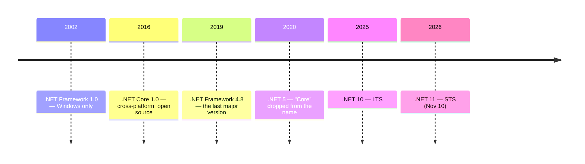
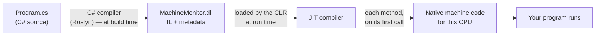

# 1.1 · How a C# program runs

!!! abstract "Goals"
    By the end of this lesson you can:

    - explain the difference between **C#**, **.NET**, the **CLR**, the **SDK** and the **runtime**
    - describe what happens from `Program.cs` to a running program: **compiler → IL → JIT → machine code**
    - explain what **managed code** means
    - create, build, run and publish a console app with the **`dotnet` CLI**, and read every file it generates

**Why this matters:** "What's the difference between .NET Framework and .NET?" and "What happens when you run a C# program?" are classic opening questions in .NET interviews. They're easy points — if you can answer them cleanly.

---

## 1. C# is the language, .NET is the platform

People say "C#" and ".NET" as if they were the same thing. They aren't.

- **C#** is a **programming language**: the syntax and rules you write in (`class`, `if`, `async`, …).
- **.NET** is the **platform** that builds and runs your program. It's made of three main parts:

| Part | What it is | Example |
| --- | --- | --- |
| **Runtime (CLR)** | The engine that runs your compiled program | Manages memory, compiles code to machine instructions, handles exceptions |
| **Base Class Library (BCL)** | Thousands of ready-made types you use every day | `List<T>`, `Dictionary<K,V>`, `File`, `HttpClient`, `DateTime` |
| **SDK** | The tools to build programs | The compiler, the `dotnet` CLI, project templates |

C# is not the only .NET language — F# and VB.NET also run on .NET — but C# is by far the most used.

!!! tip "An analogy from the factory"
    C# is the **recipe** you write. .NET is the **production line**: the machines (runtime) that execute it, the stock of standard parts you don't have to build yourself (BCL), and the tools to set the line up (SDK).

---

## 2. .NET Framework, .NET Core, .NET — a short history

This is the part that confuses everyone, so it's worth getting straight:



- **.NET Framework** (2002) is the original. **Windows only**, closed source for most of its life. Its last major version is 4.8: it's still supported because it ships with Windows, but it only gets fixes — no new features. You'll still meet it in old enterprise systems.
- **.NET Core** (2016) was a rewrite: **cross-platform** (Windows, Linux, macOS), **open source**, much faster.
- From **.NET 5** (2020) the "Core" was dropped: today it's just **.NET**, and all new development happens here.

**Release rhythm:** a new version every **November**. Even numbers are **LTS** (Long Term Support, 3 years); odd numbers are **STS** (Standard Term Support, 2 years). Right now (November 2026) the supported versions are **.NET 10 (LTS)** and **.NET 11 (STS)**; .NET 8 and 9 reached end of support this month.

Companies usually stick to **LTS** versions, so this course uses **.NET 10**. Everything works the same on .NET 11.

!!! warning "C# version ≠ .NET version"
    They're numbered separately. .NET 10 ships with **C# 14**, .NET 11 with **C# 15**. Don't say "I know C# 10" when you mean .NET 10.

!!! question "In an interview: *What's the difference between .NET Framework and .NET?*"
    "**.NET Framework** is the original, Windows-only platform. Its last version is 4.8, and it only gets maintenance fixes now. **.NET** — formerly .NET Core — is the modern rewrite: cross-platform, open source and faster, with a new version every year. New projects use .NET; .NET Framework is mainly found in legacy systems."

---

## 3. From source code to a running program

Here's what actually happens when you run your program:



**Step 1 — Build time: C# → IL.** The C# compiler (called **Roslyn**) does *not* produce machine code. It produces **IL** (Intermediate Language, also called CIL or MSIL): a CPU-independent set of instructions, stored in an **assembly** (a `.dll` file) together with **metadata** — a description of every type, method and property in it.

**Step 2 — Run time: IL → machine code.** When the program starts, the **CLR** (Common Language Runtime) loads the assembly. Its **JIT compiler** ("just-in-time") turns IL into native machine code for the CPU it's running on — **one method at a time, the first time that method is called**. Methods that get called a lot are later recompiled with heavier optimizations (this is called *tiered compilation*).

So is C# compiled or interpreted? **Compiled — twice.** Once to IL when you build, once to machine code by the JIT when you run. Nothing is interpreted line by line.

!!! info "Why the extra IL step?"
    The same `.dll` runs on Windows, Linux and macOS, on Intel or ARM CPUs: the JIT on each machine produces the right native code for *that* machine. The metadata is also what makes reflection, debugging and tooling (IntelliSense, NuGet) possible.

    There are also ways to compile ahead of time when start-up speed matters (**ReadyToRun**, **Native AOT**) — you just need to know they exist.

!!! example "Want to see IL with your own eyes?"
    Paste a few lines of C# into [sharplab.io](https://sharplab.io) and switch the output to **IL**. Optional, but it makes the idea very concrete.

### What the CLR does while your program runs

Your code runs **under the control of the CLR** — that's what **managed code** means. The CLR takes care of:

- **JIT compilation** (above)
- **Memory management** — the **garbage collector** frees objects you no longer use. You never call `free` like in C. (Lesson in section 3.)
- **Type safety** — you can't treat a `string` as an `int` by accident, or read memory outside an array (you get an `IndexOutOfRangeException` instead of corrupting memory).
- **Exception handling** — consistent across all .NET code.

!!! question "In an interview: *What happens when you run a C# program?*"
    "The C# compiler turns the source into **IL**, stored in an assembly with metadata. At run time the **CLR** loads the assembly, and the **JIT** compiles each method to native machine code the first time it's called. While it runs, the CLR also handles memory through the **garbage collector**, type safety and exceptions — that's why it's called **managed code**."

---

## 4. SDK vs runtime

| | **SDK** | **Runtime** |
| --- | --- | --- |
| Purpose | **Build** programs | **Run** programs |
| Contains | Compiler, `dotnet` CLI, MSBuild, templates — *and* the runtimes | Only the CLR + libraries |
| Where you need it | Your development machine, the CI server | Production servers, users' machines |

There isn't just one runtime. The main ones:

- **Microsoft.NETCore.App** — the base runtime, needed by every .NET app
- **Microsoft.AspNetCore.App** — adds what web apps and APIs need (the one your backends will use)
- **Microsoft.WindowsDesktop.App** — WinForms/WPF, Windows only

Useful commands:

```bash
dotnet --info            # everything: SDKs, runtimes, OS
dotnet --list-sdks       # installed SDKs
dotnet --list-runtimes   # installed runtimes
```

!!! question "In an interview: *What's the difference between the .NET SDK and the runtime?*"
    "The **SDK** is for building: it includes the compiler, the CLI and the runtimes. The **runtime** is only for running an already-compiled app. A developer machine or build server needs the SDK; a production server only needs the runtime — for an API, the ASP.NET Core runtime."

---

## 5. The `dotnet` CLI

Visual Studio and Rider call these same commands for you behind the buttons. Knowing them is useful for CI pipelines, Docker and Linux servers — and in interviews.

| Command | What it does |
| --- | --- |
| `dotnet new console -n MachineMonitor` | Creates a new console project in a `MachineMonitor` folder |
| `dotnet new list` | Lists the available templates (`console`, `webapi`, `classlib`, `xunit`…) |
| `dotnet build` | Restores packages and compiles to IL |
| `dotnet run` | Builds (if needed) and runs — for **development** |
| `dotnet add package <Name>` | Adds a NuGet package |
| `dotnet test` | Runs the tests |
| `dotnet publish -c Release` | Produces the optimized, deployable output — for **production** |
| `dotnet new gitignore` | Creates a `.gitignore` for .NET projects |

---

## 6. Anatomy of a console project

`dotnet new console -n MachineMonitor` creates this:

```
MachineMonitor/
├── MachineMonitor.csproj   ← the project file
├── Program.cs              ← your code
└── obj/                    ← generated by restore/build
```

### The `.csproj` file

```xml
<Project Sdk="Microsoft.NET.Sdk">          <!-- (1) -->

  <PropertyGroup>
    <OutputType>Exe</OutputType>             <!-- (2) -->
    <TargetFramework>net10.0</TargetFramework> <!-- (3) -->
    <ImplicitUsings>enable</ImplicitUsings>  <!-- (4) -->
    <Nullable>enable</Nullable>              <!-- (5) -->
  </PropertyGroup>

</Project>
```

1. **`Sdk="Microsoft.NET.Sdk"`** — which set of build rules to use. Web projects use `Microsoft.NET.Sdk.Web`, which adds everything ASP.NET Core needs.
2. **`OutputType Exe`** — produce a runnable program. A class library (code meant to be used by other projects) leaves this out and produces just a `.dll`.
3. **`TargetFramework`** — which .NET version to build for. `net10.0` = .NET 10.
4. **`ImplicitUsings`** — common namespaces (`System`, `System.IO`, `System.Collections.Generic`, `System.Linq`…) are imported automatically, so you don't write `using System;` everywhere.
5. **`Nullable`** — turns on **nullable reference types**: the compiler warns you when something might be `null` and you use it without checking. (More in the lesson on null.)

When you add a NuGet package, a line like this appears:

```xml
<ItemGroup>
  <PackageReference Include="Humanizer" Version="2.14.1" />
</ItemGroup>
```

**NuGet** is .NET's package manager — the equivalent of npm for JavaScript or pip for Python.

### `Program.cs` and top-level statements

```csharp
// See https://aka.ms/new-console-template for more information
Console.WriteLine("Hello, World!");
```

No `class`, no `static void Main`? This is called **top-level statements**: the compiler generates the `Program` class and the `Main` method for you, behind the scenes. Inside top-level code you also get, for free:

- **`args`** — a `string[]` with the command-line arguments
- **`return <int>;`** — the program's **exit code** (`0` = success, anything else = error). Scripts and CI pipelines check it to know whether a program failed.

The "classic" equivalent, which you'll still see in older code, is:

```csharp
class Program
{
    static int Main(string[] args)
    {
        Console.WriteLine("Hello, World!");
        return 0;
    }
}
```

### What `dotnet build` produces

After a build, look inside `bin/Debug/net10.0/`:

| File | What it is |
| --- | --- |
| `MachineMonitor.dll` | **Your assembly**: the IL + metadata. This is the real program. |
| `MachineMonitor.exe` (Windows) / `MachineMonitor` (Linux, macOS) | A small native **launcher** that starts the runtime and loads the `.dll` |
| `MachineMonitor.runtimeconfig.json` | Which runtime and version the app needs |
| `MachineMonitor.deps.json` | The list of dependencies (packages) |
| `MachineMonitor.pdb` | Debug symbols: they map IL back to your source lines, for the debugger and stack traces |

You can run the assembly directly with `dotnet MachineMonitor.dll` — that's how .NET apps usually run in Docker containers.

**Debug vs Release:** `Debug` (the default) is built for debugging, with no optimizations. `Release` (`-c Release`) is optimized: that's what goes to production. `dotnet publish -c Release` puts everything needed to deploy into `bin/Release/net10.0/publish/`.

**An assembly**, in one sentence: the unit of compiled code in .NET — a `.dll` (or `.exe`) containing IL, metadata, and a manifest with its name, version and dependencies.

---

## Common mistakes

- **"C# compiles to machine code."** No: to IL. The JIT produces machine code at run time.
- **Mixing up C# and .NET versions.** .NET 10 ≠ C# 10.
- **Committing `bin/` and `obj/` to Git.** They're generated on every build. Use `dotnet new gitignore`.
- **Using `dotnet run` in production.** It's a development command: it checks and builds every time. In production you deploy the output of `dotnet publish`.
- **Saying "the .NET Framework" for modern .NET.** In an interview it suggests you don't know the difference.

---

## Summary

- **C#** is the language; **.NET** is the platform: runtime (**CLR**) + libraries (**BCL**) + tools (**SDK**).
- **.NET Framework** = old, Windows-only, maintenance only. **.NET** (ex-Core) = modern, cross-platform, yearly in November; even = LTS. Today: .NET 10 LTS, .NET 11 STS.
- Build: C# → **IL** in an **assembly**. Run: the **CLR** loads it and the **JIT** compiles each method to machine code on first call.
- **Managed code** = code run under the CLR: garbage collector, type safety, exceptions.
- **SDK** to build, **runtime** to run.
- `.csproj` = SDK, output type, target framework, implicit usings, nullable, package references.
- **Top-level statements**: the compiler generates `Main`; you get `args` and can `return` an exit code.

---

## Exercises

Work in the repository, in **`exercises/01-csharp-fundamentals/1.1-how-a-csharp-program-runs/`**. Write everything yourself — no AI, no copy-paste from this page. When you're done, push and ask for a review in the chat.

### Exercise 1 — Your environment *(5 min)*

Run `dotnet --list-sdks` and `dotnet --list-runtimes`. In a file `answers.md`:

1. Which SDK versions do you have installed? Which runtimes?
2. In one sentence each: what's the difference between `Microsoft.NETCore.App` and `Microsoft.AspNetCore.App`?

If you don't have the **.NET 10 SDK**, install it from [dot.net](https://dotnet.microsoft.com/download).

### Exercise 2 — Create and dissect a project *(10 min)*

1. With the CLI only (no Visual Studio wizard), create a console project called `MachineMonitor` inside the exercise folder.
2. Create a `.gitignore` with the CLI.
3. In `answers.md`, explain **in your own words** what each line of the generated `.csproj` does.

### Exercise 3 — A small command-line program *(20–30 min)*

Write `MachineMonitor` so that it takes **two command-line arguments**: a machine name and the number of pieces produced.

```bash
dotnet run -- PRESS-01 520
```

Expected behaviour:

| Input | Output | Exit code |
| --- | --- | --- |
| `PRESS-01 520` | `PRESS-01 produced 520 pieces.` | `0` |
| *(no arguments)* or only one | `Usage: MachineMonitor <machine> <pieces>` | `1` |
| `PRESS-01 abc` | `Error: 'abc' is not a valid number of pieces.` | `2` |
| `PRESS-01 -5` | `Error: pieces cannot be negative.` | `2` |

Requirements:

- Use **top-level statements**.
- The program must **never crash with an exception**, whatever the input.
- Check the exit code after each run: `echo $?` (Git Bash, Linux, macOS) or `$LASTEXITCODE` (PowerShell).

??? tip "Hint — open only if you're stuck"
    You already met the tool for turning a string into a number *without* exceptions in the entry exam. And in top-level statements, `return` works at the top level too.

### Exercise 4 — Build, run the assembly, publish *(10 min)*

1. Run `dotnet build`, then run the program **directly from the `.dll`**, without `dotnet run`.
2. Run `dotnet publish -c Release`. Where did the output go? Which files are there?
3. In `answers.md`: what is each file in `bin/Debug/net10.0/` for?

### Bonus — Your first NuGet package *(10 min)*

Add the **Humanizer** package with the CLI and use it to print the number of pieces in words as well (e.g. `520` → `five hundred and twenty`). Look at what changed in the `.csproj`.

---

## Explain it

Answer in `answers.md`, **in English**, in your own words, as if an interviewer asked you. Two or three sentences each.

1. What's the difference between C# and .NET?
2. What's the difference between .NET Framework and .NET?
3. What happens, step by step, when you run a C# program?
4. What is "managed code"?
5. Is C# compiled or interpreted?

---

## Official docs

- [What is .NET? — Introduction and overview](https://learn.microsoft.com/en-us/dotnet/core/introduction)
- [Managed execution process](https://learn.microsoft.com/en-us/dotnet/standard/managed-execution-process)
- [Common Language Runtime (CLR) overview](https://learn.microsoft.com/en-us/dotnet/standard/clr)
- [.NET releases, patches and support](https://learn.microsoft.com/en-us/dotnet/core/releases-and-support)
- [.NET CLI overview](https://learn.microsoft.com/en-us/dotnet/core/tools/)
- [Top-level statements](https://learn.microsoft.com/en-us/dotnet/csharp/fundamentals/program-structure/top-level-statements)
